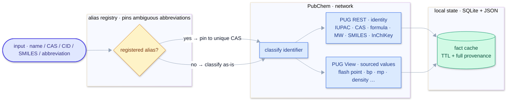
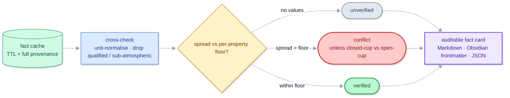
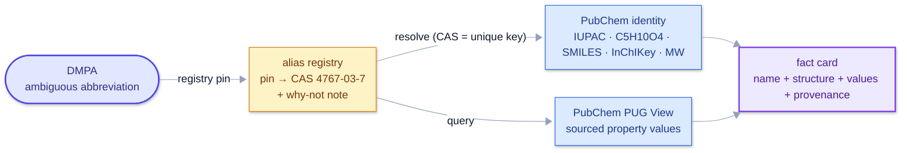
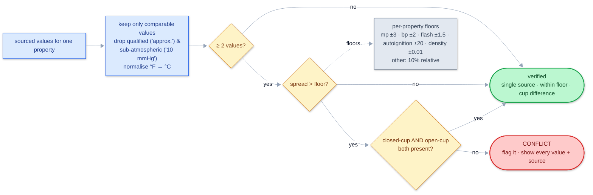
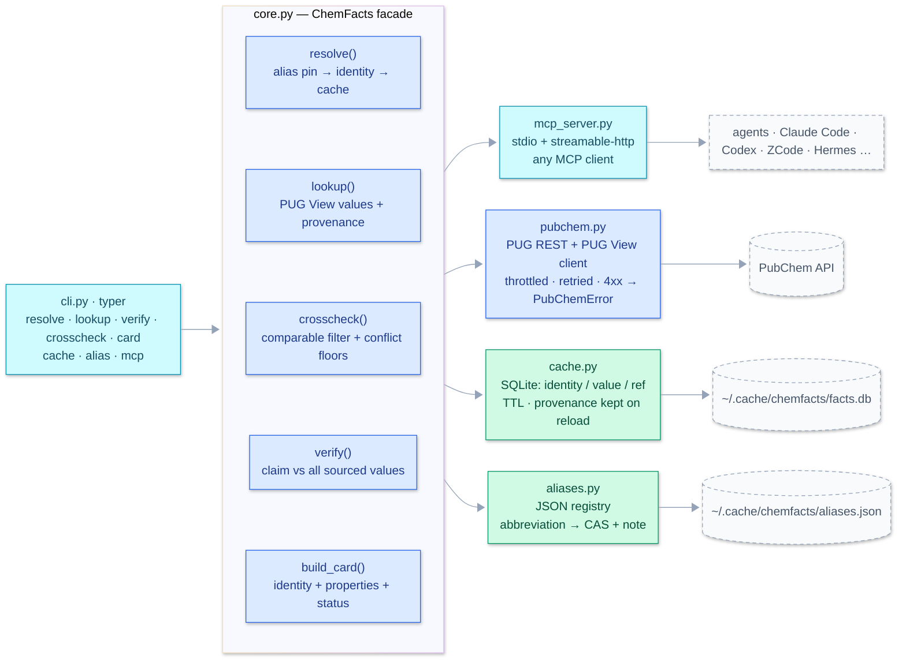

# chemfacts

**Provenance-first chemical fact verification.**

Every number chemfacts reports is *sourced, dated, and cross-checked*; if a value
cannot be sourced, it says so instead of inventing one. Chemical property values
(molecular weight, flash point, melting/boiling point, …) are the classic place where
both humans and LLMs quietly get things wrong *confidently* — a mis-copied digit, a
value remembered from the wrong compound, "a literature value". chemfacts exists to
make that failure mode impossible.

[English](README.md) | [中文文档](README_zh.md)

> **Pick it up and use it?** Read the [User Manual](docs/USAGE.md) /
> [使用手册（中文）](docs/USAGE_zh.md) — feature reference, operating guide, and
> verifiable evidence (every example is a real, replayable output).

## A real catch

```
$ chemfacts verify "1,12-diisocyanatododecane" mw --claim "262.35"
verdict: MISMATCH
detail : claim 262.35 not confirmed; closest sourced value: 252.35 g/mol (PubChem PUG REST)
```

Now pin the ambiguous abbreviation to the compound you actually use:

```
$ chemfacts alias add H12MDI 5124-30-1 --note "hydrogenated MDI, not 1,12-diisocyanatododecane"
$ chemfacts verify H12MDI mw --claim "262.35"
verdict: CONFIRMED
```

The *same* number is wrong for one compound and right for the other. chemfacts only
knows the difference because the abbreviation was pinned. That pin is a two-line JSON
entry, not a memory.

## How it works



Step 1 — **resolve** a query into identity + sourced values:
pin the abbreviation (if registered), classify the identifier, pull
PubChem, and cache locally with provenance.



Step 2 — **verify**: cross-check the cached values against
per-property conflict floors; whatever the outcome, everything lands
in one auditable card.


Two design rules hold everywhere:

1. **No fabrication.** Absence of data is reported as absence
   ("no sourced value found for: Boiling Point"), never filled in.
2. **Provenance on every value** — source name (HSDB, ILO ICSC, EPA, CAMEO, …),
   PubChem reference number, access date, and `experimental` vs `computed` kind.

## Abbreviation disambiguation

One abbreviation can mean several compounds (DMPA is dimethylolpropionic acid *or*
dimethylpiperazine; H12MDI is hydrogenated MDI *or* 1,12-diisocyanatododecane; BA is
butyl acrylate). The registry resolves that once, for every subsequent lookup:



What is pinned and why: a registry entry stores only the **small, stable, unambiguous
part** — the abbreviation and its pinned CAS plus a note recording *why* this
compound was chosen (and which ones were not). Structure, name, and InChIKey are
*derived* from the CAS at resolution time, so they can never drift out of sync with
the values. The entry format:

```json
{
  "DMPA": {
    "identifier": "4767-03-7",
    "note": "dimethylolpropionic acid, anionic WPU component; NOT 1,4-dimethylpiperazine / TMEDA",
    "added": "2026-10-20"
  }
}
```

```bash
$ chemfacts alias add DMPA 4767-03-7 --note "dimethylolpropionic acid, NOT dimethylpiperazine"
pinned DMPA -> 4767-03-7 (2026-10-20)
$ chemfacts alias list
DMPA       -> 4767-03-7  # dimethylolpropionic acid, NOT dimethylpiperazine
$ chemfacts alias show DMPA
$ chemfacts alias remove DMPA
```

The file is plain JSON (`~/.cache/chemfacts/aliases.json` by default; override with
`CHEMFACTS_ALIASES`), so you can keep it next to your fact-card vault and commit it
to version control. See [aliases.example.json](aliases.example.json).

## Status logic



Per-property floors keep normal source-to-source variation from being flagged:
melting point ±3 °C, boiling point ±2 °C, flash point ±1.5 °C, autoignition ±20 °C,
density ±0.01 g/cm³; everything else uses a 10 % relative threshold.

## Architecture



## Commands

| Command | What |
|---|---|
| `chemfacts resolve <id>` | Resolve a name / CAS / SMILES / InChI / CID (or a pinned abbreviation) to identity: IUPAC, CAS, formula, MW, SMILES, InChIKey |
| `chemfacts lookup <id> <property>` | Every *sourced* value of a property, each tagged with source, reference #, kind, access date |
| `chemfacts card <id> [--format md\|obsidian\|json] [--out file]` | An auditable fact card, ready for a lab notebook, manuscript, or Obsidian vault |
| `chemfacts verify <id> <property> --claim <value>` | Hold a claimed value against all sourced values → `confirmed` / `mismatch` (closest value + its source) / `not_found` |
| `chemfacts crosscheck <id> <property>` | Compare sourced values; flag real conflicts, tolerate closed-cup/open-cup differences |
| `chemfacts alias add\|list\|show\|remove` | Manage the abbreviation → compound registry |
| `chemfacts cache clear\|show` | Manage the local SQLite fact cache |

Property slugs: `flash-point`, `boiling-point`, `melting-point`, `density`,
`solubility`, `vapor-pressure`, `autoignition-point`, `explosive-limits`,
`surface-tension`, `viscosity`, `mw`, `formula`.

## Install

```bash
pip install chemfacts
# or
uv tool install chemfacts
```

Requires Python ≥ 3.11.

## Examples

```bash
# identity
$ chemfacts resolve NMP
identity        : N-Methyl-2-pyrrolidone
CID             : 13387
CAS             : 872-50-4
IUPAC           : 1-methylpyrrolidin-2-one
Formula         : C5H9NO
MW              : 99.13 g/mol
SMILES          : CN1CCCC1=O

# every sourced flash point, with provenance
$ chemfacts lookup NMP flash-point
96 °C                                                  | HSDB (ref #46, experimental) | 2026-10-20
204 °F (96 °C) (OPEN CUP)                              | HSDB (ref #46, experimental) | 2026-10-20

# fact card into an Obsidian vault
$ chemfacts card IPDI --format obsidian --out ~/vault/chemical-facts/IPDI.md
wrote /home/you/vault/chemical-facts/IPDI.md  (status: verified)

# verify a number you (or your model) wrote down
$ chemfacts verify NMP mw --claim "99.13"
verdict: CONFIRMED
$ chemfacts verify NMP mw --claim "110.0"
verdict: MISMATCH
detail : claim 110.0 not confirmed; closest sourced value: 99.13 g/mol (PubChem PUG REST)
```

## Use from any agent: MCP server

chemfacts ships an [MCP](https://modelcontextprotocol.io) server, so *any*
MCP-capable agent (Claude Code, Codex, ZCode, Hermes, agent harnesses, ...) can
verify chemical facts by provenance. Six tools are exposed:
`chemfacts_resolve`, `chemfacts_lookup`, `chemfacts_crosscheck`,
`chemfacts_verify`, `chemfacts_card`, `chemfacts_alias`.

### Option 1 — local stdio (no service to run)

```bash
pip install chemfacts
```

Register the `chemfacts-mcp` command with your agent (one entry each; exact
syntax varies by agent/version, the command is always `chemfacts-mcp`
which defaults to stdio):

| Agent | Example registration |
|---|---|
| Claude Code | `claude mcp add chemfacts -- chemfacts-mcp` (or a `mcpServers` entry in `.mcp.json`) |
| Codex | an MCP-server entry for `chemfacts-mcp` in Codex's config |
| Hermes | register `chemfacts-mcp` as a local MCP server (joins the academic MCP group) |

### Option 2 — shared service (Docker + streamable-HTTP, one deployment for many clients)

```bash
docker build -t chemfacts-mcp .
docker run -d -p 8000:8000 -v chemfacts-data:/data chemfacts-mcp
```

Every agent then points at the same URL `http://<host>:8000/mcp`
(e.g. `claude mcp add --transport http chemfacts http://host:8000/mcp`).
The `/data` volume **is the shared retrieval database**:
`facts.db` (SQLite cache, provenance kept on reload) +
`aliases.json` (abbreviation pins) — edit the file, all clients see it.

> If the host machine runs a global HTTP proxy, set `NO_PROXY=127.0.0.1,localhost`
> so agent↔server traffic on localhost is not routed through it.

## Library

```python
from chemfacts import ChemFacts, card_to_markdown

f = ChemFacts()
ident = f.resolve("IPDI")                       # -> CompoundIdentity (CID, CAS, formula, MW, ...)
vals = f.lookup("IPDI", "flash-point")          # -> [PropertyValue, ...] each with source + date
res = f.verify("IPDI", "mw", "222.28")          # -> VerifyResult(verdict="confirmed", ...)
card = f.build_card("IPDI")                     # -> FactCard
print(card_to_markdown(card, obsidian=True))
```

## Caching & provenance

All fetched facts land in a local SQLite database (`~/.cache/chemfacts/facts.db`,
override with `CHEMFACTS_CACHE_DIR`); each row keeps its source and access date.
Entries age out (default 30 days, `ChemFacts(ttl_days=…)`), after which values are
re-fetched — the provenance is never lost, only refreshed.

| Variable | Default | Purpose |
|---|---|---|
| `CHEMFACTS_CACHE_DIR` | `~/.cache/chemfacts` | fact cache DB location |
| `CHEMFACTS_ALIASES` | `<cache dir>/aliases.json` | abbreviation registry file |

## Sources

v0.2 uses **PubChem** (PUG REST for identity, PUG View for experimental property
values aggregated from HSDB, ILO ICSC, EPA, CAMEO, NTP, …). Second-source
cross-checking (NIST WebBook, GESTIS/ECHA) is on the roadmap.

## Roadmap

- [x] PubChem identity + experimental properties, card / verify / crosscheck, SQLite cache
- [x] Abbreviation registry: pin ambiguous names to one compound (JSON, user-editable)
- [ ] NIST WebBook as a second source (phase-transition data)
- [ ] GESTIS / ECHA / vendor SDS for authoritative flash points
- [ ] `batch` mode: verify a whole reagent list for a recipe in one pass
- [x] MCP server: stdio + streamable-http transports, Docker image, six tools — register in any MCP client

## Development

```bash
uv sync
uv run ruff check .
uv run pytest -m "not live"   # offline suite (fake PubChem client + real SQLite)
uv run pytest -m live         # hits the real PubChem API
```

## License

MIT — see [LICENSE](LICENSE).

## Disclaimer

chemfacts reports *published* values with their sources; it is a research aid, not a
safety system. For anything safety-critical (flash points, explosive limits), confirm
against the SDS of the exact product you hold in your hand.
