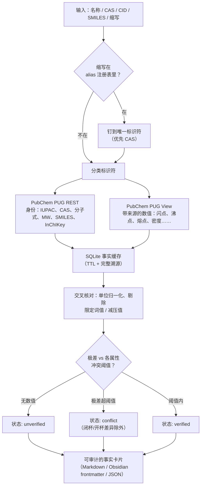
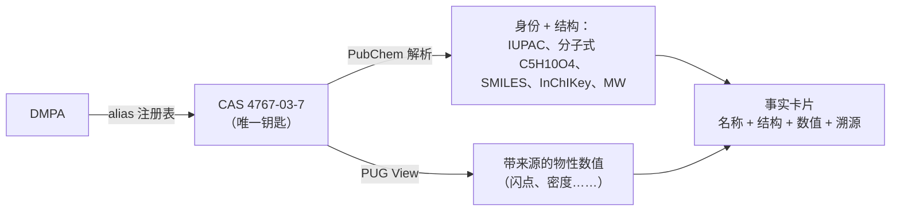
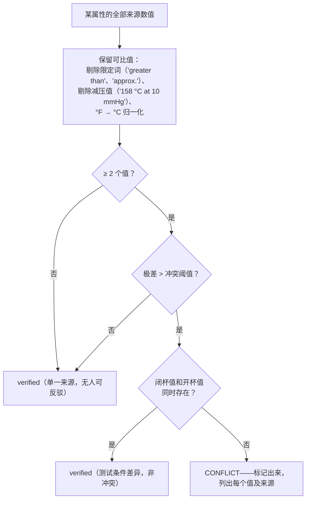
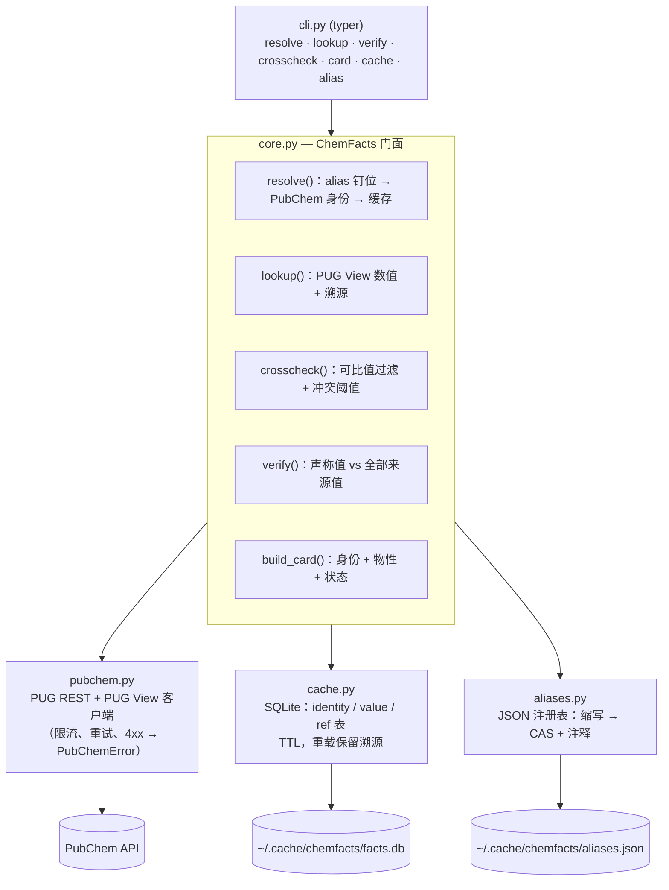

# chemfacts

**溯源优先的化学事实查证工具。**

chemfacts 报告的每一个数字都是**有来源、有日期、经交叉核对**的；查不到就明说查不到，绝不编造。化学物性数值（分子量、闪点、熔沸点……）正是人和大模型最容易"自信地报错"的地方——抄错的数字、记串的物质、"某个文献值"。chemfacts 就是让这种错误不可能发生的工具。

[English](README.md) | [中文文档](README_zh.md)

## 一个真实抓错的例子

```
$ chemfacts verify "1,12-diisocyanatododecane" mw --claim "262.35"
verdict: MISMATCH
detail : claim 262.35 not confirmed; closest sourced value: 252.35 g/mol (PubChem PUG REST)
```

把含糊的缩写钉到你实际使用的那个物质上：

```
$ chemfacts alias add H12MDI 5124-30-1 --note "hydrogenated MDI, not 1,12-diisocyanatododecane"
$ chemfacts verify H12MDI mw --claim "262.35"
verdict: CONFIRMED
```

**同一个数字 262.35，在一个物质上是错的，在另一个物质上是对的。** chemfacts 之所以分得清，是因为缩写被"钉"（pin）住了。这个钉子只是一个两行的 JSON 条目，不是一段需要记住的记忆。

## 工作原理



两条设计规则贯穿始终：

1. **不编造。** 数据缺失就报缺失（"no sourced value found for: Boiling Point"），绝不填补。
2. **每个数值都带溯源**——来源名（HSDB、ILO ICSC、EPA、CAMEO…）、PubChem 参考文献号、查证日期、`experimental`（实测）还是 `computed`（计算）。

## 缩写消歧（alias registry）

同一个缩写可以指好几种物质：DMPA 可能是二甲基丙二酸*或*1,4-二甲基哌嗪；H12MDI 可能是氢化 MDI*或*1,12-二异氰酸酯十二烷；BA 是丁基丙烯酸酯。注册表把这个歧义一次性解决，之后所有查询都走同一个答案：



**钉什么、为什么这么设计**：注册表条目只存**小而稳定且无歧义**的部分——缩写 + 钉死的 CAS + 一条"为什么选这个、排除哪些"的注释。结构式、名称、InChIKey 在解析时由 CAS 现查现得，永不与数值脱节。条目格式：

```json
{
  "DMPA": {
    "identifier": "4767-03-7",
    "note": "dimethylolpropionic acid, anionic WPU component; NOT 1,4-dimethylpiperazine / TMEDA",
    "added": "2026-10-20"
  }
}
```

```bash
$ chemfacts alias add DMPA 4767-03-7 --note "dimethylolpropionic acid, NOT dimethylpiperazine"
pinned DMPA -> 4767-03-7 (2026-10-20)
$ chemfacts alias list
DMPA       -> 4767-03-7  # dimethylolpropionic acid, NOT dimethylpiperazine
$ chemfacts alias show DMPA
$ chemfacts alias remove DMPA
```

文件是纯 JSON（默认 `~/.cache/chemfacts/aliases.json`，可用 `CHEMFACTS_ALIASES` 覆盖），可以放在事实卡片库旁边、提交到版本控制。见 [aliases.example.json](aliases.example.json)。

## 状态判定逻辑



各属性的冲突阈值（floor）避免把正常来源波动误报为冲突：熔点 ±3 °C、沸点 ±2 °C、闪点 ±1.5 °C、自燃点 ±20 °C、密度 ±0.01 g/cm³；其余属性用 10 % 相对阈值。

## 模块结构



## 命令一览

| 命令 | 作用 |
|---|---|
| `chemfacts resolve <id>` | 把名称 / CAS / SMILES / InChI / CID（或已钉住的缩写）解析为身份：IUPAC、CAS、分子式、MW、SMILES、InChIKey |
| `chemfacts lookup <id> <property>` | 列出某属性**全部带来源**的数值（来源、文献号、实测/计算、日期） |
| `chemfacts card <id> [--format md\|obsidian\|json] [--out 文件]` | 生成可审计的事实卡片，可直接进实验记录本、论文或 Obsidian 库 |
| `chemfacts verify <id> <property> --claim <值>` | 本项目的核心：把声称值对照全部来源值 → `confirmed` / `mismatch`（附最接近值+来源）/ `not_found` |
| `chemfacts crosscheck <id> <property>` | 交叉核对来源值；标记真冲突，容忍闭杯/开杯差异 |
| `chemfacts alias add\|list\|show\|remove` | 管理缩写 → 物质注册表 |
| `chemfacts cache clear\|show` | 管理本地 SQLite 事实缓存 |

属性 slug：`flash-point`、`boiling-point`、`melting-point`、`density`、`solubility`、`vapor-pressure`、`autoignition-point`、`explosive-limits`、`surface-tension`、`viscosity`、`mw`、`formula`。

## 安装

```bash
pip install chemfacts
# 或
uv tool install chemfacts
```

需要 Python ≥ 3.11。

## 示例

```bash
# 身份解析
$ chemfacts resolve NMP
identity        : N-Methyl-2-pyrrolidone
CID             : 13387
CAS             : 872-50-4
IUPAC           : 1-methylpyrrolidin-2-one
Formula         : C5H9NO
MW              : 99.13 g/mol
SMILES          : CN1CCCC1=O

# 某属性全部来源值 + 溯源
$ chemfacts lookup NMP flash-point
96 °C                                                  | HSDB (ref #46, experimental) | 2026-10-20
204 °F (96 °C) (OPEN CUP)                              | HSDB (ref #46, experimental) | 2026-10-20

# 事实卡片进 Obsidian
$ chemfacts card IPDI --format obsidian --out ~/vault/chemical-facts/IPDI.md
wrote /home/you/vault/chemical-facts/IPDI.md  (status: verified)

# 核对你（或你的模型）写下的数字
$ chemfacts verify NMP mw --claim "99.13"
verdict: CONFIRMED
$ chemfacts verify NMP mw --claim "110.0"
verdict: MISMATCH
detail : claim 110.0 not confirmed; closest sourced value: 99.13 g/mol (PubChem PUG REST)
```

## 库（Python API）

```python
from chemfacts import ChemFacts, card_to_markdown

f = ChemFacts()
ident = f.resolve("IPDI")                     # -> CompoundIdentity（CID、CAS、分子式、MW…）
vals = f.lookup("IPDI", "flash-point")        # -> [PropertyValue, ...] 每个值带来源+日期
res = f.verify("IPDI", "mw", "222.28")        # -> VerifyResult(verdict="confirmed", ...)
card = f.build_card("IPDI")                   # -> FactCard
print(card_to_markdown(card, obsidian=True))
```

## 缓存与溯源

所有抓取的事实都落到本地 SQLite（`~/.cache/chemfacts/facts.db`，可用
`CHEMFACTS_CACHE_DIR` 覆盖），每行保留来源和查证日期。条目过期（默认 30 天，
`ChemFacts(ttl_days=…)`）后重新抓取——溯源不丢失，只刷新。

| 环境变量 | 默认值 | 用途 |
|---|---|---|
| `CHEMFACTS_CACHE_DIR` | `~/.cache/chemfacts` | 事实缓存目录 |
| `CHEMFACTS_ALIASES` | `<缓存目录>/aliases.json` | 缩写注册表文件 |

## 数据来源

v0.2 使用 **PubChem**（PUG REST 查身份，PUG View 查实测物性——聚合自 HSDB、ILO ICSC、
EPA、CAMEO、NTP 等）。第二来源交叉核对（NIST WebBook、GESTIS/ECHA）在路线图中。

## 路线图

- [x] PubChem 身份 + 实测物性，card / verify / crosscheck，SQLite 缓存
- [x] 缩写注册表：把含糊名称钉到一个物质（JSON，用户可编辑）
- [ ] NIST WebBook 作为第二来源（相变数据）
- [ ] GESTIS / ECHA / 厂商 SDS 的权威闪点
- [ ] `batch` 模式：一次核完配方里的全部试剂
- [ ] MCP server：让 LLM agent 的化学声称必须走溯源

## 开发

```bash
uv sync
uv run ruff check .
uv run pytest -m "not live"   # 离线测试（假 PubChem 客户端 + 真实 SQLite）
uv run pytest -m live         # 打真实 PubChem API
```

## 许可证

MIT — 见 [LICENSE](LICENSE)。

## 免责声明

chemfacts 报告的是**已发表**数值及其来源；它是研究辅助工具，不是安全系统。
涉及安全的关键数据（闪点、爆炸极限），务必以你手上那瓶试剂的 SDS 为准。
