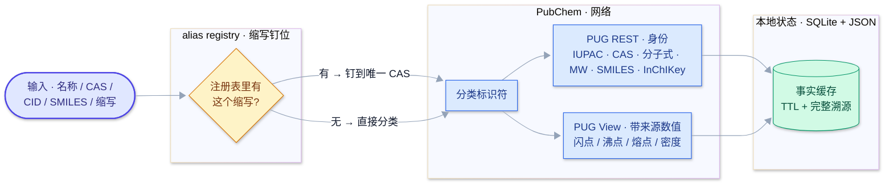
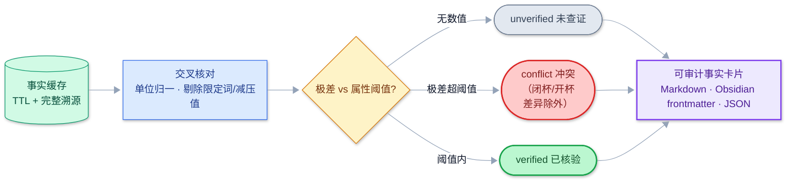
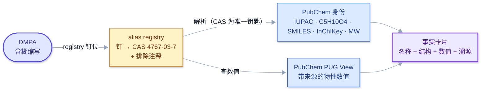
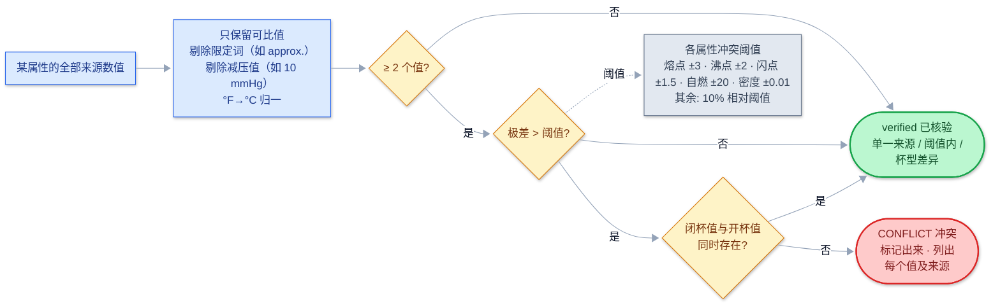
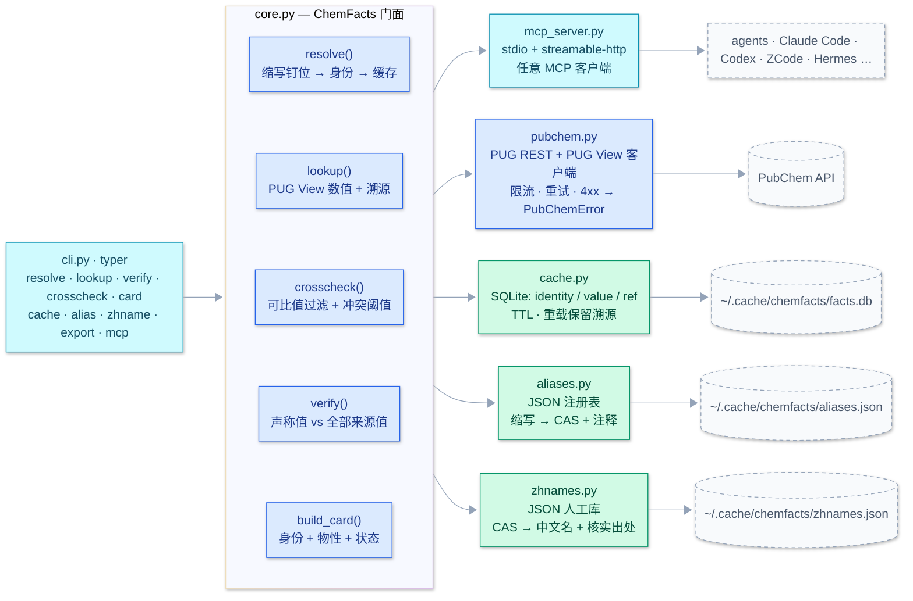

# chemfacts

**溯源优先的化学事实查证工具。**

chemfacts 报告的每一个数字都是**有来源、有日期、经交叉核对**的；查不到就明说查不到，绝不编造。化学物性数值（分子量、闪点、熔沸点……）正是人和大模型最容易"自信地报错"的地方——抄错的数字、记串的物质、"某个文献值"。chemfacts 就是让这种错误不可能发生的工具。

输入不限于名字：CAS 号、CID、SMILES、InChI(Key)、IUPAC、缩写（经注册表钉位）都能直接查——`chemfacts resolve 872-50-4` 一步给出 NMP（CID 13387）的完整身份。CAS 号是各类标识符之间的"锚"：卡片、总表与两份注册表都按它为键，保证同一个物质在所有出口都是同一个答案。

[English](README.md) | [中文文档](README_zh.md)

> **想拿起来就用？** 读[使用手册（中文）](docs/USAGE_zh.md) / [User Manual（EN）](docs/USAGE.md)——功能说明、操作指引、可复核证据（每个示例都是真实可重放的输出）。
> 带图解、可打印排版的版本：[功能手册（HTML）](docs/USAGE_manual.html)。
> 线上阅读（GitHub Pages）：<https://cl4y68.github.io/chemfacts/docs/USAGE_manual.html>。

## 一个真实抓错的例子

```
$ chemfacts verify "1,12-diisocyanatododecane" mw --claim "262.35"
verdict: MISMATCH
detail : claim 262.35 not confirmed; closest sourced value: 252.35 g/mol (PubChem PUG REST)
```

把含糊的缩写钉到你实际使用的那个物质上：

```
$ chemfacts alias add H12MDI 5124-30-1 --note "hydrogenated MDI, not 1,12-diisocyanatododecane"
$ chemfacts verify H12MDI mw --claim "262.35"
verdict: CONFIRMED
```

**同一个数字 262.35，在一个物质上是错的，在另一个物质上是对的。** chemfacts 之所以分得清，是因为缩写被"钉"（pin）住了。这个钉子只是一个两行的 JSON 条目，不是一段需要记住的记忆。

## 工作原理



第一步 — **解析**：把查询解析成身份 + 带来源数值
（缩写已注册就钉到 CAS，否则直接分类），拉取 PubChem 并连同溯源一起入本地缓存。



第二步 — **核验**：用各属性的冲突阈值交叉核对缓存里的数值；无论结果如何，
全部写进一张可审计卡片。


两条设计规则贯穿始终：

1. **不编造。** 数据缺失就报缺失（"no sourced value found for: Boiling Point"），绝不填补。
2. **每个数值都带溯源**——来源名（HSDB、ILO ICSC、EPA、CAMEO…）、PubChem 参考文献号、查证日期、`experimental`（实测）还是 `computed`（计算）。

## 缩写消歧（alias registry）

同一个缩写可以指好几种物质：DMPA 可能是二甲基丙二酸*或*1,4-二甲基哌嗪；H12MDI 可能是氢化 MDI*或*1,12-二异氰酸酯十二烷；BA 是丁基丙烯酸酯。注册表把这个歧义一次性解决，之后所有查询都走同一个答案：



**钉什么、为什么这么设计**：注册表条目只存**小而稳定且无歧义**的部分——缩写 + 钉死的 CAS + 一条"为什么选这个、排除哪些"的注释。结构式、名称、InChIKey 在解析时由 CAS 现查现得，永不与数值脱节。条目格式：

```json
{
  "DMPA": {
    "identifier": "4767-03-7",
    "note": "dimethylolpropionic acid, anionic WPU component; NOT 1,4-dimethylpiperazine / TMEDA",
    "added": "2026-10-20"
  }
}
```

```bash
$ chemfacts alias add DMPA 4767-03-7 --note "dimethylolpropionic acid, NOT dimethylpiperazine"
pinned DMPA -> 4767-03-7 (2026-10-20)
$ chemfacts alias list
DMPA       -> 4767-03-7  # dimethylolpropionic acid, NOT dimethylpiperazine
$ chemfacts alias show DMPA
$ chemfacts alias remove DMPA
```

文件是纯 JSON（默认 `~/.cache/chemfacts/aliases.json`，可用 `CHEMFACTS_ALIASES` 覆盖），可以放在事实卡片库旁边、提交到版本控制。见 [aliases.example.json](aliases.example.json)。

## 状态判定逻辑



各属性的冲突阈值（floor）避免把正常来源波动误报为冲突：熔点 ±3 °C、沸点 ±2 °C、闪点 ±1.5 °C、自燃点 ±20 °C、密度 ±0.01 g/cm³；其余属性用 10 % 相对阈值。

## 模块结构



## 命令一览

| 命令 | 作用 |
|---|---|
| `chemfacts resolve <id>` | 把名称 / CAS / SMILES / InChI / CID（或已钉住的缩写）解析为身份：IUPAC、CAS、分子式、MW、SMILES、InChIKey |
| `chemfacts lookup <id> <property>` | 列出某属性**全部带来源**的数值（来源、文献号、实测/计算、日期） |
| `chemfacts card <id> [--format md\|obsidian\|json] [--out 文件]` | 生成可审计的事实卡片，可直接进实验记录本、论文或 Obsidian 库 |
| `chemfacts verify <id> <property> --claim <值>` | 本项目的核心：把声称值对照全部来源值 → `confirmed` / `mismatch`（附最接近值+来源）/ `not_found` |
| `chemfacts crosscheck <id> <property>` | 交叉核对来源值；标记真冲突，容忍闭杯/开杯差异 |
| `chemfacts export <ids…> [--all-aliases] [--format csv\|md\|json] [--out 文件] [--fresh]` | 总对应表：缩写 → 中文名 → 英文名 → IUPAC → CAS → CID → 分子式 → MW → 熔/沸/闪点/密度，每个物性值带来源。联网优先：本地库空了/过期了照样出表 |
| `chemfacts zhname add\|list\|show\|remove` | 维护中文名（PubChem 没有中文名，本工具也绝不编造）——`zhnames.json`，按 CAS 落键，记录核实出处 |
| `chemfacts manual add\|list\|show\|remove` | 登记 PubChem 没有的物质（聚合物/混合物/商品级）：值按你写的内容原样存 `manuals.json`，export 总表里该行必带"（人工条目 · 无 PubChem 记录）"标记 |
| `chemfacts alias add\|list\|show\|remove` | 管理缩写 → 物质注册表 |
| `chemfacts cache clear\|show` | 管理本地 SQLite 事实缓存 |

属性 slug：`flash-point`、`boiling-point`、`melting-point`、`vaporization-enthalpy`（前三者同时与 NIST WebBook 交叉核对）、`density`、`solubility`、`vapor-pressure`、`autoignition-point`、`explosive-limits`、`surface-tension`、`viscosity`、`mw`、`formula`。

## 安装

```bash
# 主渠道：从 PyPI 安装
pip install chemfacts
# 备选：从 GitHub 装（PyPI 发版前的最新开发版）
git clone https://github.com/CL4Y68/chemfacts.git
cd chemfacts
pip install .
# 或一行装
pip install git+https://github.com/CL4Y68/chemfacts
```

需要 Python ≥ 3.11。

## 示例

```bash
# 身份解析
$ chemfacts resolve NMP
identity        : N-Methyl-2-pyrrolidone
CID             : 13387
CAS             : 872-50-4
IUPAC           : 1-methylpyrrolidin-2-one
Formula         : C5H9NO
MW              : 99.13 g/mol
SMILES          : CN1CCCC1=O

# 某属性全部来源值 + 溯源
$ chemfacts lookup NMP flash-point
96 °C                                                  | HSDB (ref #46, experimental) | 2026-10-20
204 °F (96 °C) (OPEN CUP)                              | HSDB (ref #46, experimental) | 2026-10-20

# 事实卡片进 Obsidian
$ chemfacts card IPDI --format obsidian --out ~/vault/chemical-facts/IPDI.md
wrote /home/you/vault/chemical-facts/IPDI.md  (status: verified)

# 核对你（或你的模型）写下的数字
$ chemfacts verify NMP mw --claim "99.13"
verdict: CONFIRMED
$ chemfacts verify NMP mw --claim "110.0"
verdict: MISMATCH
detail : claim 110.0 not confirmed; closest sourced value: 99.13 g/mol (PubChem PUG REST)

# 录入中文名（PubChem 不提供；记录你核实的出处，按 CAS 落键）
$ chemfacts zhname add THF 四氢呋喃 --source "通用名 (common name)"
curated 109-99-9 -> 四氢呋喃 (2026-10-21) [resolved to Tetrahydrofuran (109-99-9)]

# 总对应表：缩写 | 中文名 | 英文名 | IUPAC | CAS | CID | 分子式 | MW | 熔 | 沸 | 闪点 | 密度（每值带来源）
$ chemfacts export tetrahydrofuran --format md
| 缩写 | 中文名 | 英文名 | IUPAC | CAS | CID | 分子式 | 分子量 | … | 熔点 | … |
|  | 四氢呋喃 | Tetrahydrofuran | oxolane | 109-99-9 | 8028 | C4H8O | 72.11 g/mol | … | -108.3 °C ; … | … |
```

## 让任意 agent 使用：MCP 服务

chemfacts 内置 [MCP](https://modelcontextprotocol.io) 服务，**任何支持 MCP 的
agent（Claude Code、Codex、ZCode、Hermes、各种 agent harness…）都能按溯源方式查证
化学事实**。暴露 6 个工具：`chemfacts_resolve`、`chemfacts_lookup`、
`chemfacts_crosscheck`、`chemfacts_verify`、`chemfacts_card`、`chemfacts_alias`。

### 方式一 · 本地 stdio（不起服务）

```bash
pip install chemfacts
```

把 `chemfacts-mcp` 命令注册给你的 agent（每家一行；具体语法随 agent/版本略有
差异，命令永远是默认 stdio 的 `chemfacts-mcp`）：

| Agent | 注册示例 |
|---|---|
| Claude Code | `claude mcp add chemfacts -- chemfacts-mcp`（或 `.mcp.json` 里加 `mcpServers` 条目） |
| Codex | 在 Codex 配置里加一条 `chemfacts-mcp` 的 MCP server 条目 |
| Hermes | 把 `chemfacts-mcp` 注册为本地 MCP server（并入你的学术 MCP 组） |

### 方式二 · 共享服务（Docker + streamable-HTTP，一次部署、多方使用）

```bash
docker build -t chemfacts-mcp .
docker run -d -p 8000:8000 -v chemfacts-data:/data chemfacts-mcp
```

所有 agent 都指向同一个 URL `http://<host>:8000/mcp`
（如 `claude mcp add --transport http chemfacts http://host:8000/mcp`）。
`/data` 卷**就是那份共享检索库**：`facts.db`（SQLite 缓存，重载保留溯源）+
`aliases.json`（缩写钉位）——改文件，所有客户端立即可见。

> 宿主机若跑全局 HTTP 代理，请设 `NO_PROXY=127.0.0.1,localhost`，
> 避免本地 agent↔server 流量被代理劫持。

## 库（Python API）

```python
from chemfacts import ChemFacts, card_to_markdown, export_rows

f = ChemFacts()
ident = f.resolve("IPDI")                     # -> CompoundIdentity（CID、CAS、分子式、MW…）
vals = f.lookup("IPDI", "flash-point")        # -> [PropertyValue, ...] 每个值带来源+日期
res = f.verify("IPDI", "mw", "222.28")        # -> VerifyResult(verdict="confirmed", ...)
card = f.build_card("IPDI")                   # -> FactCard（含 name_zh / registered_abbrevs，若已录入）
print(card_to_markdown(card, obsidian=True))
rows = export_rows(f, ["IPDI", "NMP"])        # -> 总对应表行（联网优先，空库/过期库照样出表）
```

## 缓存与溯源

所有抓取的事实都落到本地 SQLite（`~/.cache/chemfacts/facts.db`，可用
`CHEMFACTS_CACHE_DIR` 覆盖），每行保留来源和查证日期。条目过期（默认 30 天，
`ChemFacts(ttl_days=…)`）后重新抓取——溯源不丢失，只刷新。

| 环境变量 | 默认值 | 用途 |
|---|---|---|
| `CHEMFACTS_CACHE_DIR` | `~/.cache/chemfacts` | 事实缓存目录 |
| `CHEMFACTS_ALIASES` | `<缓存目录>/aliases.json` | 缩写注册表文件 |
| `CHEMFACTS_ZHNAMES` | `<缓存目录>/zhnames.json` | 中文名人工库 |
| `CHEMFACTS_MANUALS` | `<缓存目录>/manuals.json` | PubChem 没有的物质的手工条目 |

## 数据来源

v0.5.1 使用**两个独立数据库**：
- **PubChem**——PUG REST 查身份，PUG View 查实测物性（聚合自 HSDB、ILO ICSC、
  EPA、CAMEO、NTP 等，逐值带参考编号与来源名）
- **NIST WebBook**——相变数据（沸点、熔点、汽化焓），每条带 TRC 文献引用
  （作者、年份）。这三类物性的 `crosscheck` 现在比较的是**两个独立数据库**，
  而不是一个数据库自己跟自己比

中文名来自你的 `zhnames.json` 人工库（PubChem 没有，也绝不
翻译/猜测）；PubChem 没有的物质（聚合物、混合物、商品级）可以按你核实的一手值
原样记入 `manuals.json`，任何出口都带"人工条目"标记。NIST 没有该 CAS 记录
（或网络不可达）时，自动退回 PubChem 单源结果——查不到就报缺失，绝不补数。

## 路线图

- [x] PubChem 身份 + 实测物性，card / verify / crosscheck，SQLite 缓存
- [x] 缩写注册表：把含糊名称钉到一个物质（JSON，用户可编辑）
- [x] 中文名人工库（`zhname`）+ 总对应表导出（`export`），联网优先
- [x] 手工条目（`manual`）：PubChem 没有的物质按你核实的一手值原样入库，出口必带标记
- [x] NIST WebBook 作为第二来源（相变数据：沸点 / 熔点 / 汽化焓）
- [ ] GESTIS / ECHA / 厂商 SDS 的权威闪点
- [ ] `batch` 模式：一次核完配方里的全部试剂
- [x] MCP server：stdio + streamable-http 双传输、Docker 镜像、6 个工具——任意 MCP 客户端可注册

## 开发

```bash
uv sync
uv run ruff check .
uv run pytest -m "not live"   # 离线测试（假 PubChem 客户端 + 真实 SQLite）
uv run pytest -m live         # 打真实 PubChem API
```

## 许可证

MIT — 见 [LICENSE](LICENSE)。

## 免责声明

chemfacts 报告的是**已发表**数值及其来源；它是研究辅助工具，不是安全系统。
涉及安全的关键数据（闪点、爆炸极限），务必以你手上那瓶试剂的 SDS 为准。
